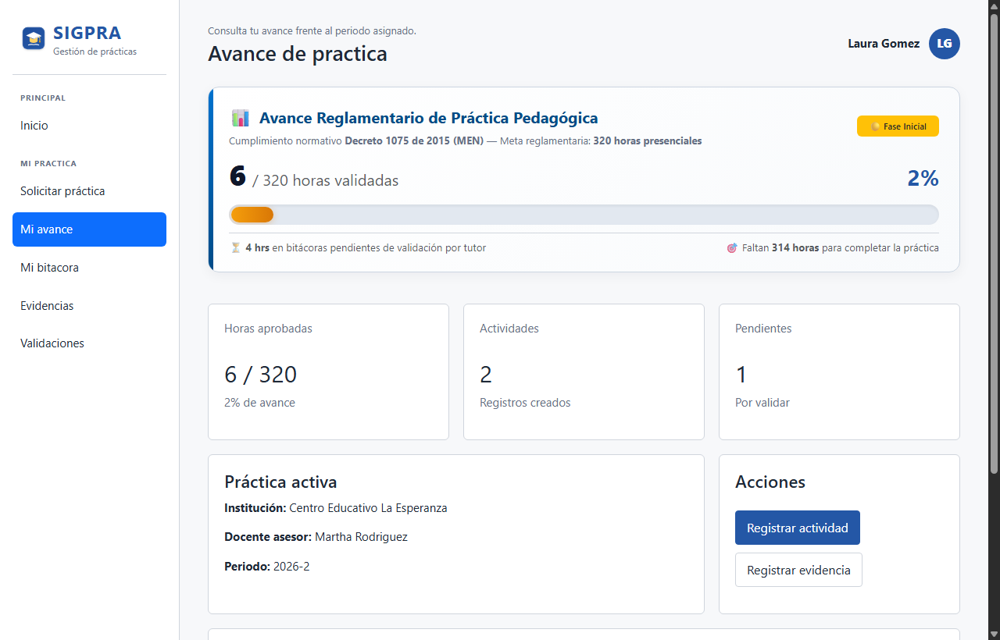
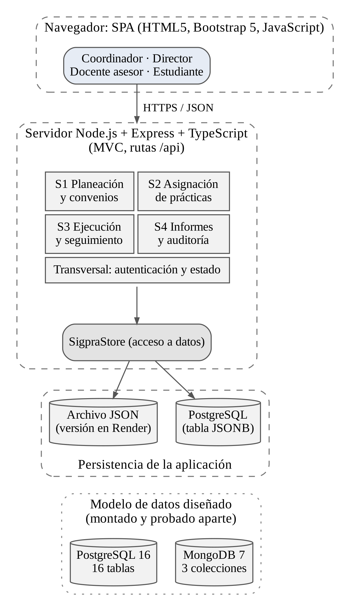

# SIGPRA: una aplicación web para gestionar las prácticas pedagógicas de las licenciaturas de la Universidad de Investigación y Desarrollo[^1]

# SIGPRA: a web application for managing teaching practicums in the education programs of Universidad de Investigación y Desarrollo

Rafael Fabián Carreño Barrera[^2], Alonso Andrés Henao Roa[^3], Jesús Daniel Rueda Castillo[^4]

Artículo entregado el 22 de noviembre de 2026

Este artículo puede compartirse bajo la [Licencia Creative Commons Atribución-NoComercial-CompartirIgual 4.0 Internacional](https://creativecommons.org/licenses/by-nc-sa/4.0/deed.es) y se referencia usando el siguiente formato: Carreño Barrera, R. F., Henao Roa, A. A. & Rueda Castillo, J. D. (2026). SIGPRA: una aplicación web para gestionar las prácticas pedagógicas de las licenciaturas de la Universidad de Investigación y Desarrollo. *I+D Revista de Investigaciones*, vol. (núm.), pp-pp. DOI:

---
# Resumen

La práctica pedagógica de las licenciaturas involucra a varias personas que trabajan en lugares y horarios distintos: el coordinador de prácticas, los colegios con convenio, los estudiantes practicantes y los docentes asesores. En la Universidad de Investigación y Desarrollo (UDI) la información de este proceso suele estar en correos, archivos personales y formatos en papel. En este artículo presentamos SIGPRA, una aplicación web que desarrollamos en el Proyecto Integrador V para apoyar el proceso desde la programación del periodo hasta el consolidado final. Trabajamos con un modelo en cascada de cinco fases, definimos siete requerimientos funcionales y ocho casos de uso, y diseñamos una arquitectura orientada a servicios con cuatro servicios comunicados por REST. La versión entregada usa Node.js, Express y TypeScript con el patrón MVC, tiene una interfaz para cada rol y está publicada en la nube. El modelo de datos se montó en PostgreSQL (16 tablas) y en MongoDB (tres colecciones) y se revisó con pruebas CRUD. La aplicación cubre los ocho casos de uso del alcance.

**Palabras clave:** práctica pedagógica, ingeniería de software, aplicación web, arquitectura orientada a servicios, gestión académica.

---
# Abstract

The teaching practicum in teacher education programs involves several people who work in different places and on different schedules: the practicum coordinator, the partner schools, the student teachers and the faculty advisors. At Universidad de Investigación y Desarrollo (UDI), the information about this process is usually kept in e-mails, personal files and paper forms. In this article we present SIGPRA, a web application we developed in the Integrative Project V course to support the process from term planning to the final consolidated report. We worked with a five-phase waterfall model, defined seven functional requirements and eight use cases, and designed a service-oriented architecture with four services that communicate through REST. The delivered version uses Node.js, Express and TypeScript with the MVC pattern, has an interface for each role and is published in the cloud. The data model was set up in PostgreSQL (16 tables) and MongoDB (three collections) and checked with CRUD tests. The application covers the eight use cases in scope.

**Keywords:** teaching practicum, software engineering, web application, service-oriented architecture, academic management.

---
# Introducción

En la práctica pedagógica el estudiante de licenciatura va a un colegio a dar clases, con el acompañamiento de un docente asesor de la universidad y de la institución que lo recibe. Las horas que cumple sirven para demostrar las condiciones de calidad que exige el Decreto Único Reglamentario del Sector Educación (Ministerio de Educación Nacional [MEN], 2015), y esa información se vuelve a revisar en la autoevaluación del programa y en la acreditación (Consejo Nacional de Acreditación [CNA], 2013). Por eso el programa necesita saber dónde se hizo cada práctica, con qué convenio, cuántas horas se aprobaron y quién evaluó al estudiante.

Al describir el proceso vimos que participan muchas personas y que casi nunca coinciden en tiempo y lugar. El coordinador define el periodo y busca las plazas. Los colegios firman o renuevan los convenios e indican cuántos practicantes pueden recibir. El estudiante reporta lo que hace y guarda sus soportes. El docente asesor visita el aula, aprueba las horas y aplica una rúbrica. Al final, el director del programa necesita un consolidado para responder ante la decanatura y los pares académicos. Cada paso depende de información que produce otra persona.

Con pocos practicantes, el correo, las hojas de cálculo y los formatos firmados son suficientes. El problema empieza cuando aumentan los estudiantes y los convenios. Los datos de un mismo practicante quedan en los archivos del coordinador, en el correo del docente y en lo que guarda el estudiante. Tampoco hay un lugar donde consultar qué convenios están vigentes y cuántos cupos quedan, y los soportes se guardan en computadores personales. Las plataformas de cursos que ya usan las universidades sirven para entregar trabajos y poner notas, pero no para manejar convenios, cupos por plaza o la validación de horas por parte de un docente asesor.

Por eso el objetivo del proyecto fue desarrollar una aplicación web para gestionar las prácticas pedagógicas de las licenciaturas de la UDI, que permitiera programar el periodo, asignar los practicantes a las instituciones, registrar y validar las actividades, y hacer el seguimiento y la evaluación por parte del docente asesor. Los objetivos específicos fueron cuatro: caracterizar el proceso con sus actores y reglas, diseñar la arquitectura y el modelo de datos, construir la aplicación con los requerimientos priorizados, y verificarla y documentarla. En el proyecto se integraron tres cursos de quinto semestre: Ingeniería del Software II, Programación III y Teoría General de Sistemas.

El artículo está organizado así. En la metodología se describen el tipo de estudio, el equipo, las herramientas, los requerimientos y el procedimiento de cada entrega. En los resultados se presentan lo que hace la aplicación, las pruebas realizadas y lo que quedó pendiente.

# Metodología

## Tipo de estudio

Es un proyecto de desarrollo tecnológico, aplicado y descriptivo. No hubo experimentos ni mediciones con usuarios reales. El producto es un sistema de software, y lo verificamos con pruebas funcionales de los requerimientos y con pruebas CRUD de la base de datos. Usamos el modelo en cascada (Royce, 1970; Sommerville, 2016) porque el alcance estaba limitado por el calendario académico y no esperábamos muchos cambios, y porque cada entrega del Proyecto Integrador coincidía con el cierre de una fase. Las fases fueron cinco: análisis de requerimientos, diseño, construcción, pruebas, y documentación y cierre. Cuando en una revisión aparecía algo que faltaba, volvíamos a la fase anterior para corregirlo, como lo permite la versión del modelo con realimentación (Pressman & Maxim, 2020).

## Participantes

No se trabajó con una muestra de personas. El equipo estuvo formado por tres estudiantes de quinto semestre de Ingeniería de Sistemas de la UDI. Los tres participamos en el análisis. Después, un integrante se encargó principalmente de la documentación y los otros dos del desarrollo y la base de datos. Los usuarios del sistema se definieron como actores. Cuatro usan la aplicación directamente: el coordinador de prácticas, el director de programa, el docente asesor y el estudiante practicante. Los otros dos son externos: la institución receptora y el sistema de información académica de la universidad, que aporta los datos de matrícula.

Para el análisis usamos el enunciado del proyecto que entregaron los docentes, la normativa y la descripción del proceso que hicimos como equipo. Las decisiones se revisaron en seis reuniones de seguimiento entre septiembre y octubre de 2026, registradas en actas. Las pruebas se hicieron con una cuenta por rol y con datos ficticios, sin información personal de estudiantes reales.

## Herramientas tecnológicas

La Tabla 1 resume las herramientas. La aplicación tiene un servidor en Node.js con Express y TypeScript, organizado en rutas, controladores, servicios y modelos, y una interfaz de una sola página hecha con HTML5, JavaScript y Bootstrap 5. Para el modelo de datos usamos PostgreSQL 16 para la información que debe mantener relaciones, y MongoDB 7 para la que cambia de un caso a otro, como los metadatos de los soportes y las bitácoras de visita (MongoDB, 2024; The PostgreSQL Global Development Group, 2024). Al final también hicimos una segunda interfaz en React 18 y Vite que usa la misma API, pero la versión publicada es la primera.

*Tabla 1.* Herramientas utilizadas en el desarrollo de SIGPRA

| **Herramienta**                   | **Uso en el proyecto**                                   |
|-----------------------------------|----------------------------------------------------------|
| Node.js 20 y Express 4            | Servidor web y API REST bajo /api                        |
| TypeScript 5.4                    | Lenguaje del servidor (patrón MVC)                       |
| HTML5, JavaScript y Bootstrap 5.3 | Interfaz de una sola página con vistas por rol           |
| PostgreSQL 16                     | Esquema relacional y modo de almacenamiento postgres     |
| MongoDB 7                         | Colecciones de soportes, bitácoras y auditoría           |
| Docker Compose                    | Entorno local con la aplicación y las dos bases de datos |
| Render                            | Publicación de la aplicación con HTTPS                   |
| Astah, Graphviz y Mermaid         | Diagramas UML y de arquitectura                          |
| Git, GitHub y GitKraken           | Control de versiones del código y de la documentación    |

## Requerimientos/Requisitos

En la primera versión teníamos requerimientos como “registrar estudiante” o “registrar institución”. En la revisión de la primera entrega vimos que eso es mantenimiento de datos y no el problema que el sistema debe resolver, así que los reescribimos en torno a la gestión de la práctica. Quedaron siete requerimientos funcionales y ocho casos de uso modelados en UML (Object Management Group [OMG], 2017). El RF-04 se dividió en dos casos de uso porque el registro lo hace el estudiante y la validación la hace el docente asesor, en momentos diferentes. La Tabla 2 relaciona los requerimientos con los casos de uso y los servicios.

*Tabla 2.* Requerimientos funcionales, casos de uso y servicio que los atiende

| **RF** | **Requerimiento**                                   | **CU**       | **Serv.** |
|--------|-----------------------------------------------------|--------------|-----------|
| RF-01  | Programación del periodo de práctica                | CU-01        | S1        |
| RF-02  | Gestión de convenios y plazas                       | CU-02        | S1        |
| RF-03  | Asignación del practicante a plaza y docente asesor | CU-03        | S2        |
| RF-04  | Registro y validación de la práctica ejecutada      | CU-04, CU-05 | S3        |
| RF-05  | Seguimiento y evaluación del practicante            | CU-06        | S3        |
| RF-06  | Consolidado del estado de las prácticas             | CU-07        | S4        |
| RF-07  | Solicitud de práctica y revisión del director       | CU-08        | S2        |

Para los requerimientos no funcionales tomamos como referencia la norma ISO/IEC 25010 (International Organization for Standardization [ISO], 2011), pero solo dejamos los que responden a una necesidad del proceso. Son cinco. El sistema debe estar disponible en los días previos al cierre de reportes, permitir que al menos 60 practicantes registren actividades al mismo tiempo y dejar registrar visitas desde el celular aunque se pierda la conexión. También debe guardar durante al menos cinco años un registro de auditoría que no se pueda modificar, y conservar los soportes durante ese mismo tiempo. Además definimos once reglas de negocio. Por ejemplo, un estudiante no puede tener dos asignaciones en el mismo periodo, solo cuentan las horas aprobadas por el docente asesor y no se aceptan actividades con fecha posterior al límite de reporte.

Cada requerimiento se convirtió en reglas concretas dentro de la aplicación. Para publicar un periodo, los pesos de la rúbrica deben sumar 100 % y la intensidad horaria debe estar entre 1 y 320 horas. Una plaza solo se ofrece si su convenio tiene documento y está vigente. Una actividad se acepta si tiene entre 0,5 y 24 horas, si su fecha está dentro del periodo y si tiene al menos un soporte en PDF, JPG, PNG, DOC o DOCX de máximo 10 MB. La nota de cada criterio de la rúbrica va de 0,0 a 5,0. Para devolver o rechazar una solicitud de práctica, el director debe escribir una justificación de mínimo diez caracteres.

## Procedimiento

El trabajo se organizó según las tres entregas del semestre. Hasta el 30 de agosto de 2026 hicimos el análisis. Describimos el proceso en seis momentos, identificamos los actores, revisamos la normativa, definimos los requerimientos y las reglas de negocio, y elaboramos en Astah el diagrama de casos de uso con sus fichas y el diagrama de dominio. En esa entrega también presentamos un primer modelo entidad-relación y un prototipo de mediana fidelidad. Con las observaciones del docente reescribimos los objetivos sin nombres de productos y planteamos la arquitectura como orientada a servicios.

Entre el 31 de agosto y el 11 de octubre hicimos el diseño. Dividimos el sistema en cuatro servicios según la información que maneja cada uno y qué tan seguido cambia: S1, planeación y convenios; S2, asignación de prácticas; S3, ejecución y seguimiento; y S4, informes y auditoría. Antes de los servicios pusimos una capa intermedia que recibe las solicitudes, revisa el rol del usuario y las envía al servicio correspondiente. Usamos la orientación a servicios para organizar el sistema (Erl, 2016) y REST con mensajes JSON para la comunicación entre servicios (Fielding, 2000). En esta fase también hicimos los diagramas de secuencia y de clases, el modelo relacional, el diccionario de datos, el prototipo de alta fidelidad y los scripts de la base de datos. El 11 de octubre ejecutamos las pruebas CRUD y entregamos un prototipo funcional con la mitad de los casos de uso.

Del 12 de octubre al 22 de noviembre terminamos la construcción, las pruebas y la documentación. En esta etapa agregamos el CU-08, la solicitud de práctica que revisa el director, porque sin él no estaba claro quién habilitaba al estudiante para ser asignado. La aplicación puede guardar sus datos de dos formas: en un archivo JSON o en PostgreSQL, en una columna JSONB donde cada cambio se hace dentro de una transacción. Publicamos la aplicación en Render, preparamos un entorno local con Docker Compose y elaboramos los diagramas de componentes y de despliegue y los manuales técnico y de usuario. El código y la documentación están en un repositorio público de GitHub.

# Resultados

## La aplicación entregada

SIGPRA cubre los ocho casos de uso del alcance (Figura 1). El coordinador programa el periodo con su rúbrica, registra instituciones, convenios y plazas, y asigna a cada practicante una plaza y un docente asesor. El estudiante radica su solicitud de práctica con la matrícula, la afiliación a EPS y ARL y el paz y salvo, y recibe un número de radicado. El director revisa los soportes y aprueba, devuelve o rechaza la solicitud. Cuando ya tiene asignación, el estudiante registra sus actividades con soportes y puede ver cuántas horas lleva aprobadas y cuántas le faltan (Figura 2). El docente asesor valida las actividades y registra las visitas con su evaluación. El coordinador y el director consultan el consolidado por periodo, programa, institución y docente, y pueden exportarlo a CSV o imprimirlo. Si hay actividades sin revisar, la aplicación lo indica y muestra el consolidado como parcial.

*Figura 1.* Diagrama de casos de uso de SIGPRA.

*Figura 2.* Vista del estudiante con el avance de horas aprobadas frente a la intensidad exigida en el periodo.

Cada rol ve solo sus opciones. Los formularios largos están divididos en etapas numeradas para llenarlos por partes, y debajo de cada formulario está la tabla con los registros. La aplicación está publicada en https://sigpra-udi.onrender.com y el código está en el repositorio del proyecto.

## Arquitectura implementada

La Figura 3 muestra la arquitectura de la versión entregada. El servidor tiene 21 rutas bajo /api, nueve controladores y siete servicios, y todo el acceso a los datos pasa por la clase SigpraStore. Cada grupo de rutas corresponde a un servicio del diseño, así que la separación de responsabilidades se mantuvo aunque todo se despliegue junto. La versión publicada usa el modo JSON. Cambiando una variable de entorno, el mismo código guarda el estado en PostgreSQL.

*Figura 3.* Arquitectura de la versión entregada de SIGPRA.

## Base de datos

El esquema relacional tiene 16 tablas, desde usuario y convenio hasta evaluación y su detalle por criterio. Algunas reglas de negocio quedaron como restricciones en la base de datos. Los cupos ocupados no pueden superar los ofrecidos, las horas de una actividad deben ser más de cero y máximo 24, la nota de cada criterio va de 0 a 5 y la fecha límite de reporte no puede ser anterior al fin del periodo. Un índice único parcial evita que un estudiante tenga dos asignaciones activas en el mismo periodo, y una vista reúne el estado de cada práctica para los informes. En MongoDB creamos tres colecciones, una para evidencias, otra para bitácoras de visita y otra para eventos de auditoría, cada una con un validador de esquema para sus campos obligatorios.

Las pruebas CRUD se hicieron sobre cuatro tablas: institución, usuario, convenio y plaza de práctica. El script crea un registro en cada tabla, lo consulta, lo actualiza y lo borra respetando las dependencias, todo dentro de una transacción. La prueba terminó sin errores de restricciones ni de llaves foráneas, y al final los cuatro conteos quedaron en cero, es decir, no quedaron datos de prueba en la base.

## Aporte de cada curso

De Ingeniería del Software II aplicamos el análisis y el modelado: la especificación de requerimientos, los casos de uso con sus fichas, los diagramas de secuencia, clases, componentes y despliegue, y la planeación por fases. En este curso también tuvimos que revisar varias veces que cada requerimiento correspondiera a lo que hacía cada pantalla.

De Programación III viene la construcción: el servidor MVC en TypeScript, las rutas de la API, la interfaz por roles, los dos modos de almacenamiento y los scripts de PostgreSQL y MongoDB con sus pruebas.

De Teoría General de Sistemas tomamos la manera de analizar el proceso. Antes de diseñar pantallas identificamos los actores, las entradas y salidas de cada momento y los límites del sistema, es decir, lo que queda por fuera, como la institución receptora o el sistema académico (Bertalanffy, 1976). El registro de auditoría y el consolidado parcial funcionan como realimentación, porque le muestran al coordinador y al director cómo va el proceso para que puedan corregir a tiempo.

## Limitaciones

La versión entregada no tiene todo lo que se diseñó. La aplicación guarda su estado en JSON o en una tabla JSONB. Las reglas de negocio se validan en el navegador y las rutas de la API no revisan el rol de quien las llama. De los soportes se guardan el nombre y la ruta prevista, pero el archivo no se sube al servidor, y las contraseñas se guardan sin cifrar. No hay notificaciones: cada usuario ve sus pendientes al entrar, pero no se envían correos ni avisos a otros usuarios. El registro de auditoría guarda quién hizo cada cambio y cuándo, pero no el valor anterior. En Render el archivo JSON no es permanente, así que cuando el servicio se reinicia los datos vuelven a los iniciales. Por último, al comparar el código con el documento vimos que el coordinador puede asignar a un estudiante cuya solicitud todavía no aprobó el director. La lista lo marca como pendiente, pero no lo bloquea.

# Conclusiones

Con SIGPRA comprobamos que el proceso de prácticas pedagógicas de la UDI se puede apoyar con una aplicación web en la que el coordinador, el director, los docentes asesores y los estudiantes consultan la misma información. Los ocho casos de uso del alcance funcionan en la versión publicada, y las acciones importantes quedan registradas con el usuario y la fecha.

Modelar el proceso completo antes de decidir qué construir nos ahorró trabajo. Como teníamos claros los seis momentos de la práctica, fue fácil ubicar cada requerimiento y darnos cuenta de que faltaba el CU-08 cuando surgió la pregunta de quién habilita al estudiante. También aprendimos que hay que revisar desde temprano que el documento y el código digan lo mismo. Al comparar cada requerimiento con lo que hacía la aplicación encontramos que el cierre del periodo no verificaba las actividades pendientes, y lo corregimos a tiempo. En cambio, exigir la solicitud aprobada antes de asignar quedó pendiente.

# Agradecimientos

Agradecemos a los profesores Jonathan Arley Monsalve Salazar (Ingeniería del Software II), John William Ruiz Zapata (Programación III) y Ricardo Vicente Jaimes Vivas (Teoría General de Sistemas) por sus revisiones en cada entrega, que nos llevaron a cambiar varias decisiones del proyecto. También agradecemos al programa de Ingeniería de Sistemas de la Universidad de Investigación y Desarrollo (UDI).

# Referencias

Bertalanffy, L. von (1976). *Teoría general de los sistemas: fundamentos, desarrollo, aplicaciones*. México: Fondo de Cultura Económica.

Consejo Nacional de Acreditación. (2013). *Lineamientos para la acreditación de programas de pregrado*. Bogotá: CNA.

Erl, T. (2016). *Service-oriented architecture: Analysis and design for services and microservices* (2.ª ed.). Boston: Prentice Hall.

Fielding, R. T. (2000). *Architectural styles and the design of network-based software architectures* (Tesis doctoral). University of California, Irvine.

International Organization for Standardization. (2011). *ISO/IEC 25010:2011. Systems and software engineering: Systems and software Quality Requirements and Evaluation (SQuaRE). System and software quality models*. Ginebra: ISO.

Ministerio de Educación Nacional. (2015). *Decreto 1075 de 2015, por medio del cual se expide el Decreto Único Reglamentario del Sector Educación*. Bogotá: MEN.

MongoDB. (2024). *Schema validation*. Recuperado de https://www.mongodb.com/docs/manual/core/schema-validation/

Object Management Group. (2017). *OMG Unified Modeling Language (OMG UML), version 2.5.1*. Recuperado de https://www.omg.org/spec/UML/2.5.1/

Pressman, R. S. & Maxim, B. R. (2020). *Software engineering: A practitioner’s approach* (9.ª ed.). Nueva York: McGraw-Hill Education.

Royce, W. W. (1970). Managing the development of large software systems. *Proceedings of IEEE WESCON*, 26, 1-9.

Sommerville, I. (2016). *Software engineering* (10.ª ed.). Boston: Pearson.

The PostgreSQL Global Development Group. (2024). *PostgreSQL 16 documentation*. Recuperado de https://www.postgresql.org/docs/16/

[^1]: Artículo de desarrollo tecnológico, enfoque cualitativo, resultado de un proyecto de aula culminado (Proyecto Integrador V), perteneciente al área de Ingeniería de Sistemas, subárea de Ingeniería de Software, desarrollado en el programa de Ingeniería de Sistemas de la Universidad de Investigación y Desarrollo (Bucaramanga, Colombia) con los cursos Ingeniería del Software II, Programación III y Teoría General de Sistemas. Fecha de inicio: agosto de 2026. Fecha de terminación: noviembre de 2026.

[^2]: Estudiante de quinto semestre de Ingeniería de Sistemas, Universidad de Investigación y Desarrollo (Bucaramanga, Colombia). Correo electrónico institucional: rcarreno4@udi.edu.co.

[^3]: Estudiante de quinto semestre de Ingeniería de Sistemas, Universidad de Investigación y Desarrollo (Bucaramanga, Colombia). Correo electrónico institucional: ahenao2@udi.edu.co.

[^4]: Estudiante de quinto semestre de Ingeniería de Sistemas, Universidad de Investigación y Desarrollo (Bucaramanga, Colombia). Correo electrónico institucional: jrueda51@udi.edu.co.
