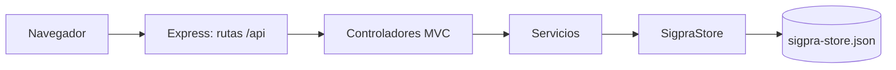
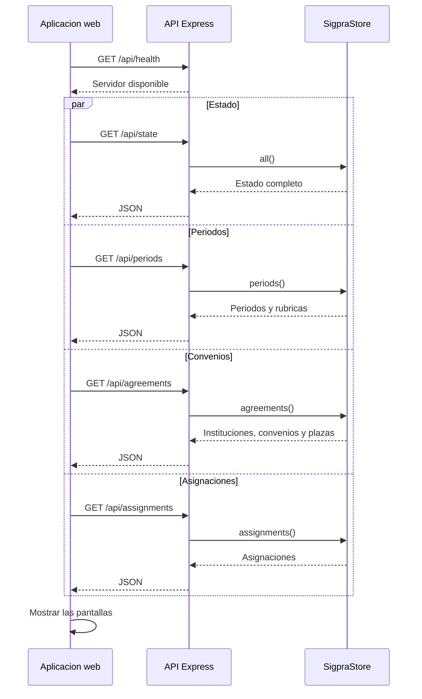
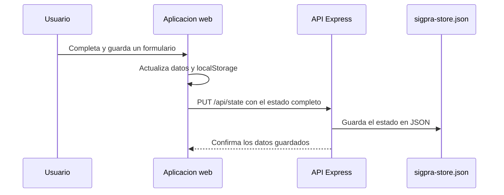

# Diagramas de funcionamiento de las APIs SIGPRA

Estos diagramas representan el funcionamiento actual de la aplicacion web.
El backend usa Node.js, Express y TypeScript con organizacion MVC. Actualmente
guarda el estado en un archivo JSON del servidor; la conexion directa con
PostgreSQL aun no esta implementada.

## Arquitectura de las APIs

## Carga inicial de la aplicacion

Las tres APIs de dominio consultadas al iniciar son:

| API | Informacion devuelta |
| --- | --- |
| `GET /api/periods` | Periodos academicos y rubricas. |
| `GET /api/agreements` | Instituciones, convenios y plazas. |
| `GET /api/assignments` | Asignaciones de practicantes. |

## Guardado desde un formulario

Las rutas `/api/periods`, `/api/agreements` y `/api/assignments` tambien
exponen `POST` para crear registros. Los formularios actuales de la interfaz
sincronizan sus cambios mediante `PUT /api/state`, no mediante esos `POST`.
