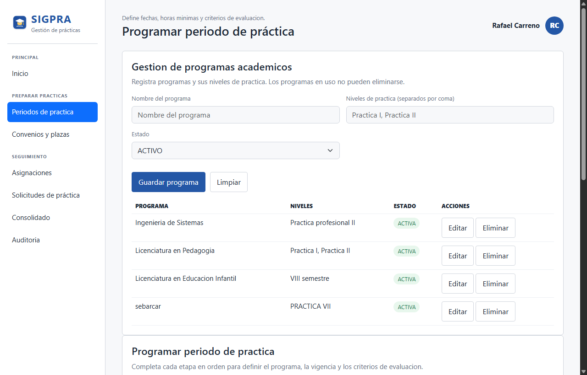
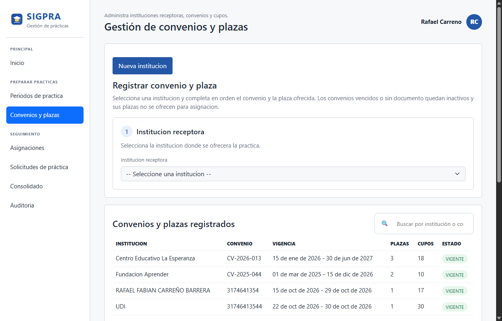
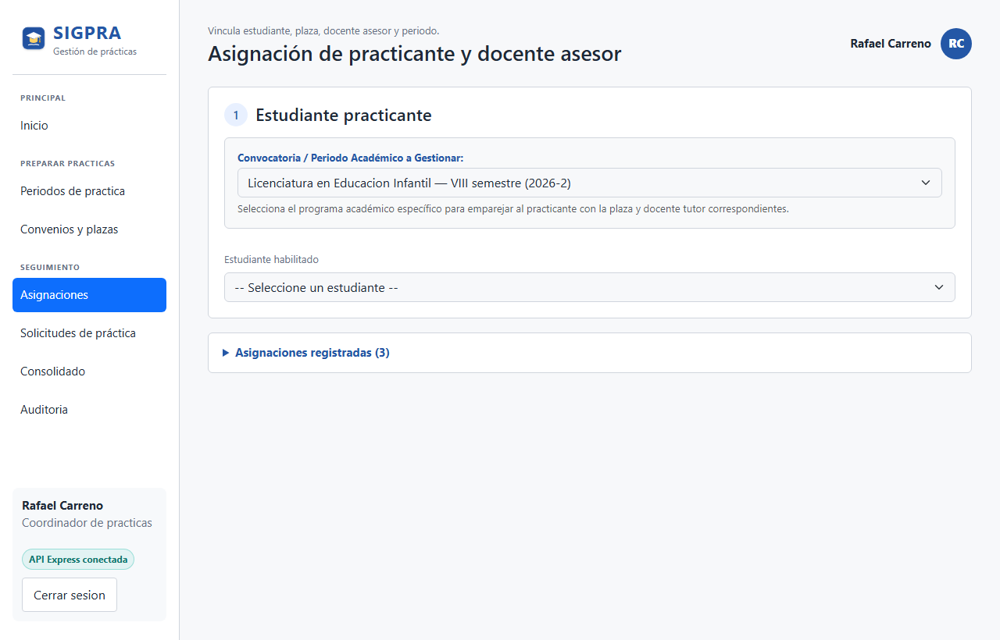
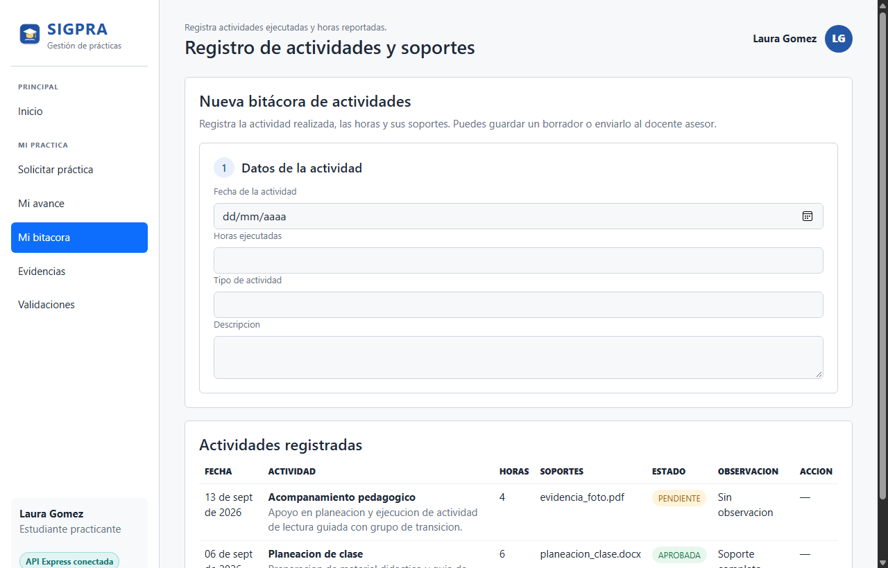
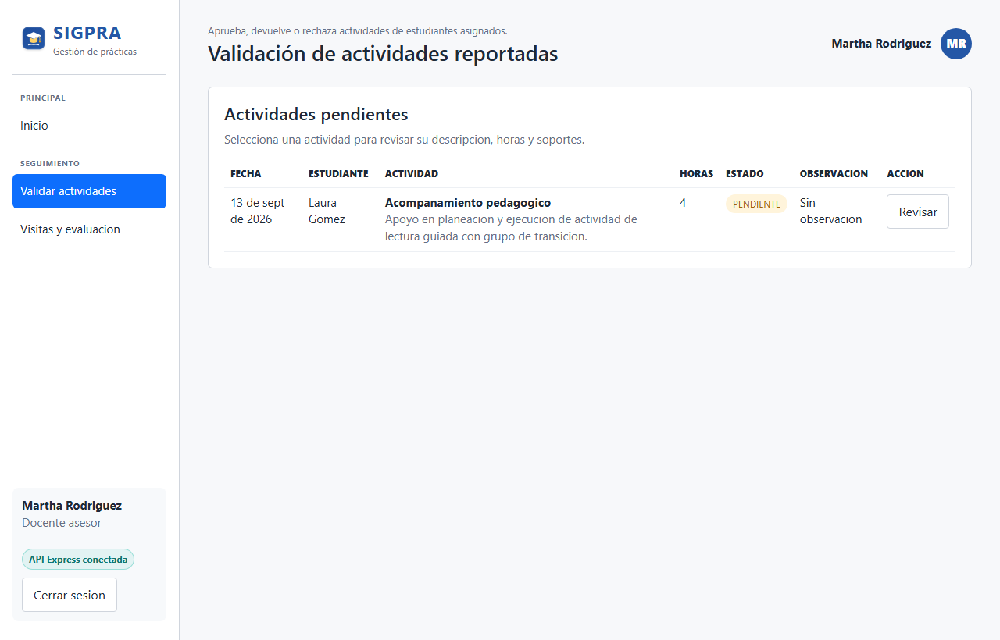
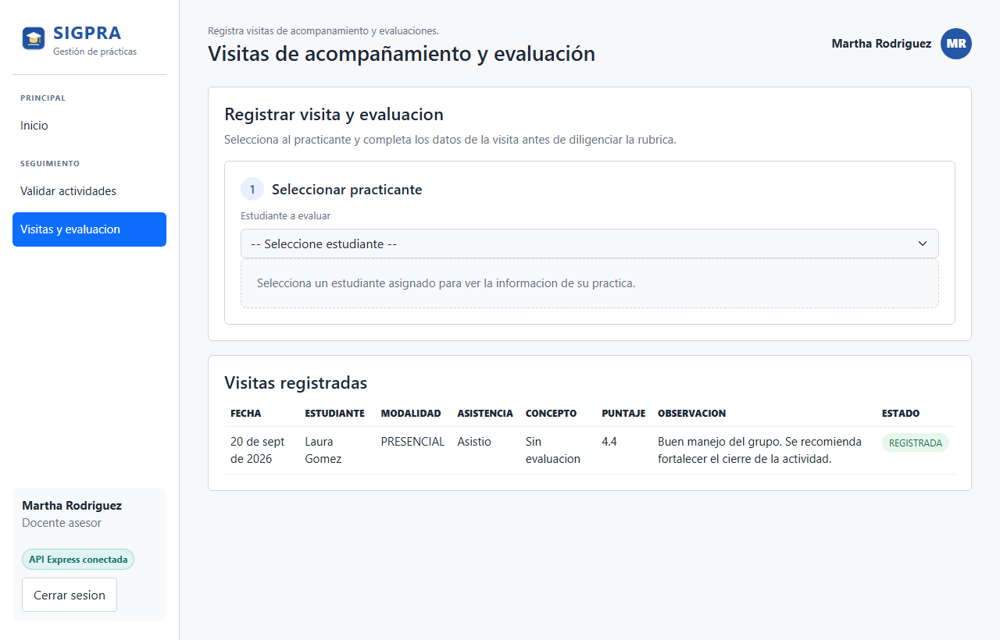
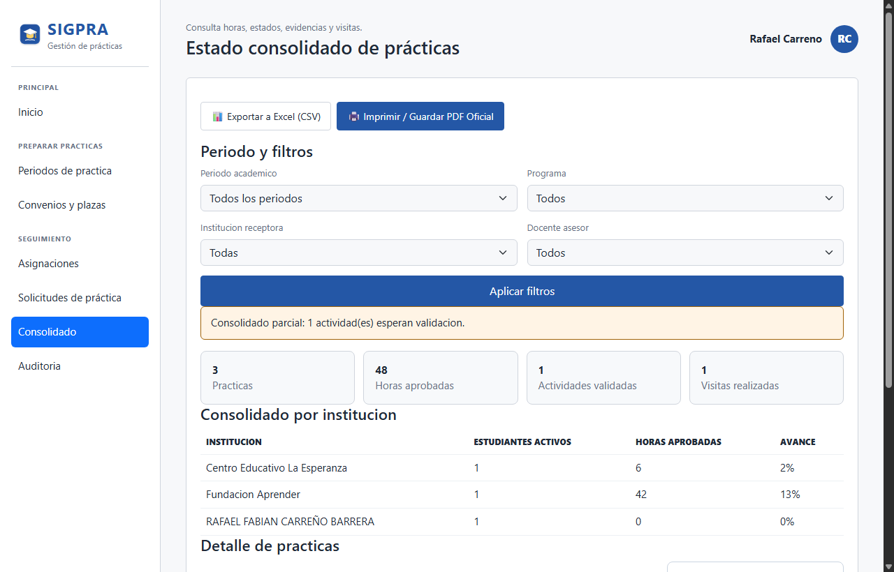
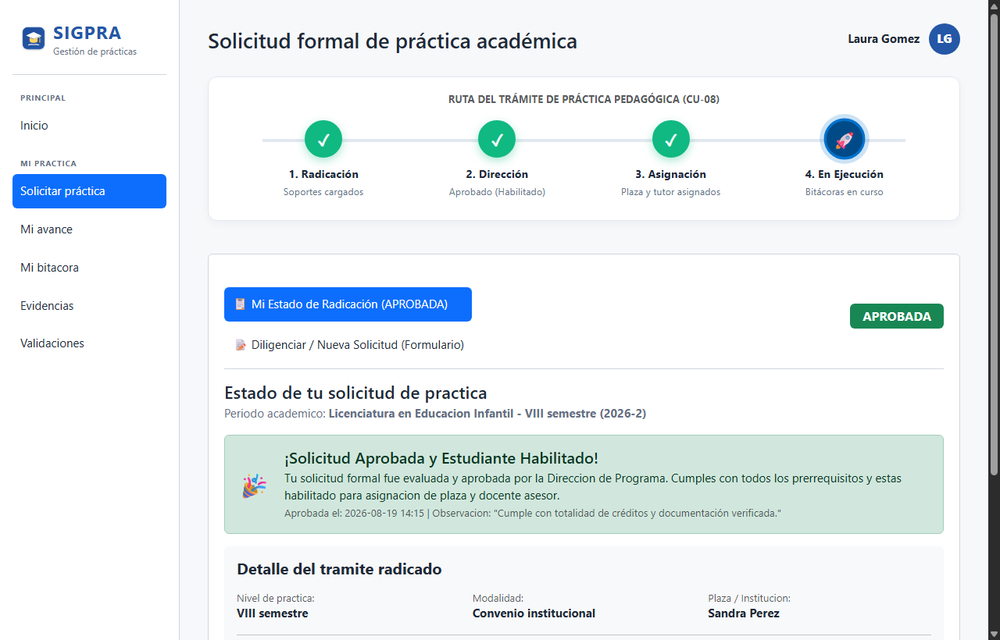
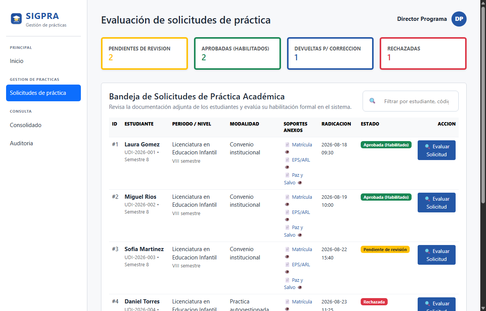
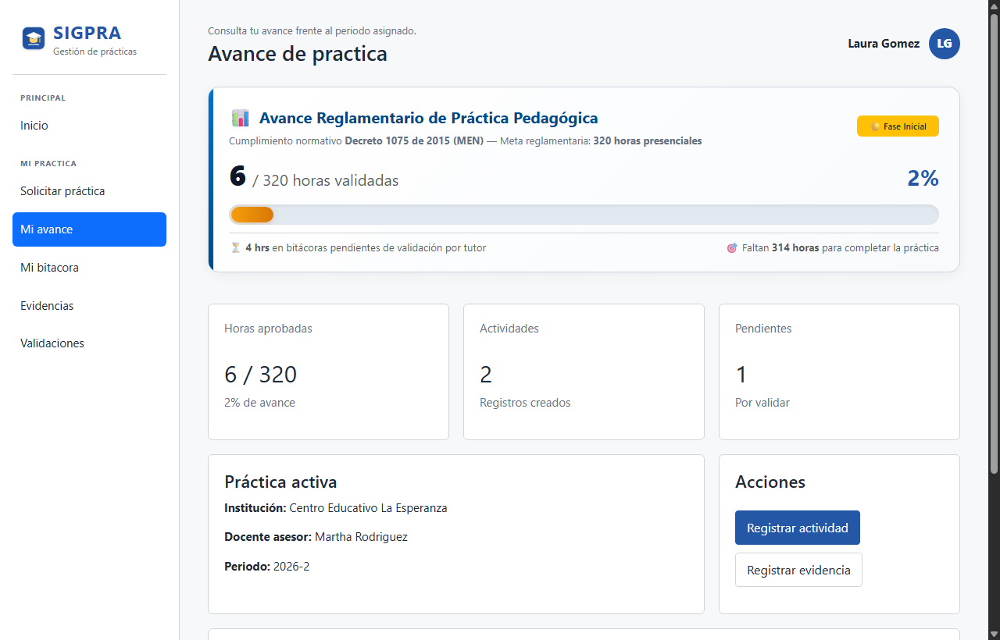

# 🎨 Prototipos de Alta Fidelidad e Interfaz Gráfica — SIGPRA
### Sistema Integral de Gestión de Prácticas Académicas
**Universidad de Investigación y Desarrollo (UDI) · Facultad de Ingenierías · Proyecto Integrador V**

---

## 🌐 1. Enlace Oficial de Prototipos en Figma

Los prototipos navegables y componentes de diseño visual de la plataforma se encuentran centralizados en el espacio de trabajo oficial de Figma:

👉 **[Abrir Prototipos SIGPRA en Figma](https://www.figma.com/design/RZYp1EuRTjzHCWiIUrWzGB/SIGPRA---Prototipos-mediana-fidelidad)**

---

## 📱 2. Catálogo de Vistas de Alta Fidelidad en Producción

La presente entrega incorpora las capturas de pantalla a **Alta Fidelidad (Full HD 1280x820 px)** correspondientes a la implementación funcional del sistema web desplegado en la nube ([https://sigpra-udi.onrender.com](https://sigpra-udi.onrender.com)), reflejando fielmente la identidad institucional de la **UDI**, la arquitectura de roles y los flujos normativos del **Decreto 1075 de 2015**:

| # | Archivo | Caso de Uso / Módulo | Rol Responsable | Descripción y Capacidades de la Interfaz |
|:---:|---|---|---|---|
| **1** | [`CU-01.png`](./CU-01.png) | **CU-01: Programar periodo de práctica** | Coordinación | Parametrización de fechas, horas mínimas normativas y ponderación de rúbrica porcentual al 100%. |
| **2** | [`CU-02.png`](./CU-02.png) | **CU-02: Gestionar convenios y plazas** | Coordinación | Vinculación de instituciones, control de vigencias, soporte contractual PDF y cupos por jornada. |
| **3** | [`CU-03.png`](./CU-03.png) | **CU-03: Asignar practicante a plaza** | Coordinación | Emparejamiento operativo Estudiante - Plaza - Docente Asesor con selector dinámico de periodo y programa afín. |
| **4** | [`CU-04.png`](./CU-04.png) | **CU-04: Registrar actividad y soportes** | Estudiante | Bitácora digital periódica de labores, horas ejecutadas y cargue de evidencias fotográficas/documentales. |
| **5** | [`CU-05.png`](./CU-05.png) | **CU-05: Validar actividades reportadas** | Docente Asesor | Bandeja de control docente, verificación de evidencias y retroalimentación pedagógica obligatoria. |
| **6** | [`CU-06.png`](./CU-06.png) | **CU-06: Visita de acompañamiento** | Docente Asesor | Registro formal de visitas in situ o remotas con calificación según rúbrica institucional. |
| **7** | [`CU-07.png`](./CU-07.png) | **CU-07: Consolidado de prácticas** | Coordinación / Dirección | Tablero analítico con buscador en tiempo real, exportación oficial a Excel (CSV) y reporte imprimible UDI. |
| **8** | [`CU-08.png`](./CU-08.png) | **CU-08: Radicación formal de práctica** | Estudiante | Radicación de prerrequisitos (Matrícula, EPS/ARL, Paz y Salvo) con Stepper interactivo de 4 etapas. |
| **9** | [`CU-08_Director.png`](./CU-08_Director.png) | **CU-08: Evaluación y dictamen formal** | Director de Programa | Bandeja de dictamen con filtro reactivo, visor apilable de soportes digitales con firma SHA-256 y habilitación formal. |
| **10** | [`Progreso_160_Horas.png`](./Progreso_160_Horas.png) | **Módulo de Seguimiento Normativo** | Estudiante | Velocímetro y barra de progreso hacia las **160 horas obligatorias** (Decreto 1075 de 2015 del MEN). |

---

## 🖼️ 3. Galería Gráfica de Prototipos de Alta Fidelidad

### CU-01. Programar periodo de práctica académica (Coordinación)

---

### CU-02. Gestionar convenios institucionales y plazas formativas (Coordinación)

---

### CU-03. Asignar practicante a plaza formativa y docente asesor (Coordinación)

---

### CU-04. Registrar actividad ejecutada y evidencias de práctica (Estudiante)

---

### CU-05. Validar actividades reportadas por practicantes (Docente Asesor)

---

### CU-06. Realizar visita de acompañamiento y evaluar desempeño (Docente Asesor)

---

### CU-07. Consultar estado consolidado de prácticas académicas (Coordinación y Dirección)

---

### CU-08. Radicación de solicitud de práctica con Stepper visual (Estudiante)

---

### CU-08. Evaluación documental, verificación y dictamen formal (Director de Programa)

---

### Módulo de Seguimiento Normativo: Cumplimiento de 160 Horas Obligatorias (Decreto 1075)

---

## 📌 4. Nota de Evolución Metodológica

En las fases tempranas del proyecto (Entregas I y II), se utilizaron prototipos estáticos de mediana fidelidad tipo wireframe para la conceptualización de los requerimientos funcionales. En esta **Entrega Final de Sustentación (Entrega III)**, todos los prototipos han evolucionado a **Alta Fidelidad Funcional**:
* Interfaces construidas con arquitectura **Responsive Web Design** (Bootstrap 5.3 + CSS3 custom properties).
* Componentes interactivos avanzados: Stepper de radicación de 4 estados, microinteracciones en tarjetas KPI, filtros instantáneos en vivo, visor digital apilable y cálculo automático de tiempos formativos.
* Despliegue en producción con conectividad HTTPS y persistencia integral.
